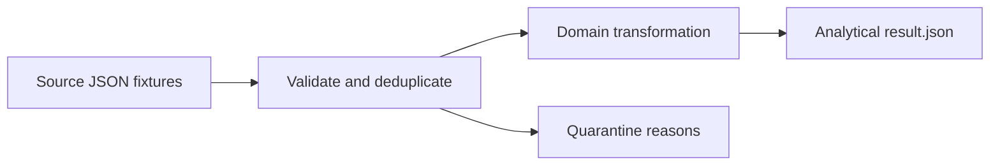

# Privacy-Aware Appointment ETL

A clinic operations analyst needs no-show metrics without publishing patient names or raw patient IDs in the analytical output. This project is a deterministic Node.js 24 ETL example using only built-in modules and synthetic data.



## Data and rules

`fixtures/appointments.json` contains entirely synthetic appointments and deliberate bad dates. One safe appointment row per accepted appointment; one metric row per clinic.

- Replace patient IDs with 16-character HMAC-SHA256 pseudonyms using `PSEUDONYM_KEY`; never export source names or IDs.
- Compute no-show rate as `NO_SHOW / (NO_SHOW + COMPLETED)`; cancelled appointments are reported but excluded from that denominator.
- Quarantine invalid or conflicting records by source index and reason only, with no source row copied into the output.
- Require real ISO-8601 calendar timestamps with an explicit timezone; the first valid appointment ID wins and later conflicting IDs are quarantined.

See the checked-in [example result](examples/result.json). The CLI overwrites that file deterministically; running it twice produces identical bytes.

## Run

Install Node.js 24. From this repository's root in PowerShell:

```powershell
node --test test/pipeline.test.mjs
$env:PSEUDONYM_KEY = 'demo-only-synthetic-key'
node pipeline.mjs
```

No npm packages, external API keys, or database are needed. Tests cover the main calculation and a material data-quality failure. This is a demonstration of data minimization, not a claim of regulatory compliance. Real data requires an approved secret-management and privacy review.
